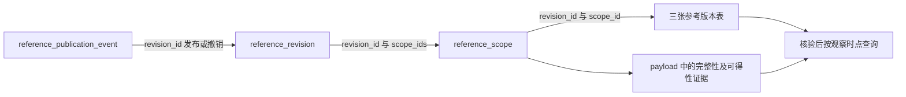

# 当前数据库表与字段讲解

本文讲解当前 `betalens` 数据库的业务结构，并配套一份覆盖全部实际字段的数据字典。结构采集时间为 **2026-11-05 20:05:46，上海时间**：PostgreSQL 的 `betalens` schema 与 ClickHouse 的 `betalens` 数据库各有 **41 张表、1,359 个字段位置**，表名、字段名及可空性一致。字段位置按“表名＋字段名”计数，同名公共字段在不同表分别计数。

先通过本页了解一行数据代表什么，再按物理表名和字段名查字典。中文名称只用于解释，不是 Datafeed 查询别名。

- [逐表、逐字段字典](../reference/database-dictionary.md)：全部字段的含义、原生类型、可空性、单位、来源及生成规则。
- [Excel 数据字典](../_static/database-dictionary-20261105.xlsx)：可筛选的表概览、完整字段字典和独立财报字段页。
- [JSON 结构与字典快照](../_static/database-schema-20261105.json)：原生目录、主键、排序键、行数及字段说明。
- [真实库 Datafeed 验收](../plans/datafeed-live-acceptance-20261105.md)：接口结果和当前 PIT 证据缺口。

## 1. 先区分三种表

**24 张普通业务表**保存证券、行情、财报、基金、行业、指数和事件。它们使用实际业务键；其中有些是当前快照，有些保留内容版本，但不能统一理解为“所有历史修订都已保留”。

**3 张参考版本表和3张发布凭证表**服务于严格行业、日历和停牌查询。记录先入库，再核验完整范围，最后以不可变事件发布；未发布或已撤销的记录不能直接参与业务查询。

**11 张管理与审计表**保存表说明、映射、导入任务镜像、批次回执、行级审计及覆盖统计。管理任务完成不等于业务参考版本已发布；表有行不等于数据已具备历史可知性。

| 分类 | 物理表 | 一行代表什么 |
| --- | --- | --- |
| 统一证券 | `security_dim` | 一个证券代码＋资产类型的当前档案 |
| 资产档案 | `stock_profile`、`fund_profile`、`index_profile`、`etf_profile` | 对应资产的来源完整档案快照 |
| 代码关系 | `security_code_history` | 一组旧代码、新代码关系及已有生效证据 |
| 日行情 | `market_daily_raw`、`market_daily_post_adjusted` | 一种资产、一个证券、一个交易日 |
| 补充行情 | `stock_quote_supplement_daily` | 一个股票、一个交易日的备用行情观测 |
| 财报 | `fundamental_periodic` | 一个证券、报告期、报表类型、报告类型、内容版本 |
| 基金日数据 | `fund_nav_daily`、`fund_shares_daily` | 一个基金、一个净值日或份额变动日 |
| 基金公告观测 | `fund_nav_observation` | 一个基金的一份净值公告内容版本 |
| 行业字典 | `industry_scheme_dim`、`industry_dim` | 一个分类体系；或体系内一个行业 |
| 普通行业归属 | `industry_membership_record`、`security_industry_membership` | 一份来源内容版本；或展开后的一个行业有效区间 |
| 指数成分 | `index_membership` | 一个指数、一个成分证券、一个快照日期 |
| 普通日历与状态 | `trade_calendar`、`trade_status_daily` | 一个交易所自然日；或一个证券日的状态观测 |
| 证券事件 | `corporate_action`、`dividend_event`、`suspension_event`、`security_name_history` | 一条摘要事件；或一份源事件内容版本 |
| 参考版本 | `stock_industry_membership_versions`、`trade_calendar_versions`、`stock_suspension_intervals_versions` | 一份修订、一个完整范围内的一条记录 |
| 发布凭证 | `reference_revision`、`reference_scope`、`reference_publication_event` | 一个修订头、完整范围凭证或发布/撤销事件 |
| 管理与审计 | `meta_*`、`import_*`、`dataset_coverage` | 元信息、任务/批次/目标状态、变更记录或覆盖统计 |

## 2. 证券代码与关联键

`security_dim` 的实际主键是 **`(security_code, asset_type)`**。同一代码字符串不能跨资产自动视为同一对象。行情表以 **`(asset_type, security_code, trade_date)`** 定位一行；与总表关联时需要同时匹配资产类型和证券代码。

各资产档案表已由表本身限定资产类别，主键为 `security_code`。ETF 是基金中的特定类别，不代表所有 `fund_profile` 记录都在交易所交易。代码对照表中的 `list_date` 是上市日，不能替代代码切换日；未证明的 `valid_from` 保持缺失。

行业字典需按 **`scheme_code + industry_code`** 关联，不能只用行业代码。指数成分中的 `index_code` 是指数身份，`security_code` 是成员身份，两个字段的角色不同。这里描述的是逻辑关联，不能据此推断数据库已建立外键约束。

## 3. 行情、复权与单位

两张行情表具有相同的 57 个字段，便于选择价格口径。`market_daily_raw` 保存股票、基金未复权价格和指数原生点位；`market_daily_post_adjusted` 保存股票、基金后复权价格，指数仍保留原生点位。

| 字段组 | 主要字段 | 阅读方法 |
| --- | --- | --- |
| 行身份 | `asset_type/security_code/trade_date` | 资产类别、证券、交易日共同定位一行 |
| 价格 | `open/high/low/close/previous_close/change` | 股票、基金为元；指数为点。后复权表中的这些价格已复权 |
| 成交 | `volume/amount/average_price` | 统一行情成交量为股或份，金额为元；均价另看资产适用性与复权口径 |
| 日频指标 | `turnover_rate/pe/pb/pe_ttm/ps_ttm/dividend_yield` 等 | 区分报告期与 TTM，不能按近似名称替换 |
| 股本与市值 | `total_shares/float_shares/total_market_value` 等 | 按声明单位读取，不再次乘“万” |
| 复权依据 | `adjustment_factor/adjustment_method/adjustment_formula/adjustment_version` | 保存因子、方式、公式和处理版本；处理版本不证明因子的历史可得性 |
| 原价格 | `raw_open/raw_high/raw_low/raw_close/raw_previous_close/raw_change` | 后复权表保留用于核对和重算的未复权价格 |

当前股票、基金价格派生公式为 `raw_price × adjustment_factor`。成交量和成交额不复权；缺因子时不能填 1 冒充正常后复权价格。指数的 `adjustment_method` 为原生点位语义。

统一行情已执行来源单位转换。例如当前股票 `daily.vol × 100` 转为股，`daily.amount × 1000` 转为元，`daily_basic.total_share × 10000` 转为股。字典逐字段列出来源、乘数和适用资产，已入库结果不能再重复转换。

`stock_quote_supplement_daily` 保留备用源字段和其单位，不能套用统一行情的换算规则。百分比字段按百分数值理解，例如声明单位 `%` 的 `5` 表示 5%，不是 500%。未声明单位的数值字段不自动视为元、百分比或无量纲。

**后复权价格直接用于回测成交手数计算是现有缺陷，仍待单独修复。** 查询价格口径不改变成交数量应根据未复权价格计算的要求。

## 4. 财报宽表为什么有 510 个字段

`fundamental_periodic` 合并保存利润表、资产负债表、现金流量表和财务指标的字段全集，一行不需要填满所有数值列。字段是否适用取决于 `statement_type`、报告类型及来源企业类别；空值可能表示不适用、未提供或缺失，不能统一补零。

实际主键为：

```text
security_code, period_end, statement_type, report_type, version_id
```

| 字段 | 含义 |
| --- | --- |
| `period_end` | 报告期末；不能当成该财报已公开的日期 |
| `statement_type` | `income`、`balancesheet`、`cashflow`、`fina_indicator`；普通/VIP 接口使用同一类型身份 |
| `report_type` | 保留来源报告类型代码；财务指标接口未提供时使用明确值 `unspecified`，不替换为 `1` |
| `announcement_date` | 源公告日期 `ann_date` |
| `actual_announcement_date` | 源实际公告日期 `f_ann_date`；仅有日期仍不证明精确公开时刻 |
| `version_id` | 内容版本身份；不是可以按大小排序的历史修订序号 |
| `available_at` | 对应内容版本可得的时刻，还需依据与质量证据 |

`revenue/net_income/total_assets/total_liabilities/operating_cashflow` 等是明确字段，不通过中文指标或逻辑指标别名查询。财报查询必须显式指定 `statement_type` 和 `report_type`。当前管理器任务按报告期规划财报请求，所选日期范围不含季度末时，可能不生成财报请求；不能因此认定期间没有公告。

`rd_exp` 是实际仍存在但已弃用的歧义列。新数据分别使用 `research_and_development_expense`（利润表研发费用）和 `research_and_development_investment`（财务指标研发投入合计）。两种来源含义不同，不能合并，也不能凭字段名字相似互相补值。字典保留该旧列是记录现有结构，不是提供旧 API 兼容。

## 5. 基金、分红和名称的不同粒度

`fund_nav_daily` 的实际主键是 `(security_code, nav_date)`，不包含公告日期；它是规范日净值表。`fund_nav_observation` 使用 `(security_code, record_version)` 保存公告内容观测，同一净值日可能有不同版本。`fund_shares_daily` 的份额规模既不是净值，也不是成交量。

`corporate_action` 是证券事件摘要，`dividend_event` 保存分红方案观测。摘要中的 `cash_dividend` 是税后每股现金分红，`share_dividend` 仅指送股比例，不含资本公积转增；方案的预案、通过、实施和除权生效日期需要分别阅读。

`security_name_history` 保留来源名称变更内容版本，当前历史查询按名称有效日期和历史可得性联合筛选。当前展示名称来自证券快照；它不能填补缺失的历史名称。

## 6. 普通参考数据与可信版本

普通表 `security_industry_membership/trade_calendar/suspension_event/trade_status_daily` 保留来源或派生观测。它们有数据，不表示行业、日历、交易状态的严格 PIT 专用接口就可以使用这些数据。

三张版本表共用物理键 **`(revision_id, scope_id, record_id)`**。物理键保留修订身份；业务范围和记录的有效区间另行判断。

| 版本表 | 完整范围 | 关键字段和边界 |
| --- | --- | --- |
| `stock_industry_membership_versions` | 股票×精确分类体系×层级的完整历史 | `scheme_code/classification_version/level/industry_code/valid_from/valid_to/boundary_basis`；有效区间左闭右开 |
| `trade_calendar_versions` | 交易所×自然日 | `exchange/trade_date/is_open`；开市、休市均需记录，缺日未知 |
| `stock_suspension_intervals_versions` | 股票×日期的完整事件集 | `suspend_type/raw_timing/start_at/end_at/parse_status`；停牌区间 `[start_at,end_at)` |

普通行业处理路径当前使用 `SW2021/CITIC`，参考域使用精确 `SW2014/SW2021/CITICS`。它们是不同合同中的真实字段值，不能在查询端偷偷转换别名。行业年份和层级都重要：未指定申万版本时，根据观察时点已发布且历史可知的版本证据选择唯一版本；不能直接默认最大年份或将两版拼在一起。

参考版本中的 `classification_version` 应与 `scheme_code` 一致；`level` 为整数 1、2、3。普通 `industry_dim.level` 的实际类型则是文本，应根据所在表的实际类型读取。

日历交易所使用精确 `SSE/SZSE/BSE`，不再把 `SHSE` 自动映射到 `SSE`。BSE 使用 SSE 参考日历时，需要在 `reference_exchange/calendar_basis` 中保留依据。交易周期参数的半年使用 `H`，这是 API 参数，不是日历表新增字段。

完整停牌范围允许零事件，通过 `reference_scope` 表达完整性。因此“停牌表没有行”与“已经证明没有停牌事件”是两种情况。Datafeed 的交易状态是 `1/0/-1/NA`；未知保留 `NA`，不能因为没有停牌记录就设为正常，也不能把它理解为涵盖所有交易规则的可成交承诺。

### 发布凭证与 payload

`reference_revision` 保存修订头，`reference_scope` 保存完整范围凭证，`reference_publication_event` 追加发布或撤销事件。三者的 `payload` 都是**包含 JSON 的文本字段**，不是在两库都声明为原生 JSON 类型。物理列只是用于索引和检查的投影，读取时要核对投影、完整载荷和哈希是否一致。

| 表的 payload | 需要阅读的内容 |
| --- | --- |
| `reference_revision.payload` | 来源/合同/任务身份、`ingestion_seq`、`scope_ids/scope_count/row_count`、`input_hash/manifest_hash` 等完整修订头 |
| `reference_scope.payload` | `selector`、行数、完整标志、内容及键哈希、`reasons`、`evidence`、`dependencies`；`evidence.availability` 说明范围本身的历史可得性 |
| `reference_publication_event.payload` | `event_id/event_seq/revision_id/event_type`、对应 `manifest_hash/scope_ids` 和撤销任务等 |

逻辑关联如下，表示读取关系，不表示数据库外键约束：



先排除未发布和已撤销修订，再核验清单、范围、内容和历史可得性，最后选择完整范围版本。不能跨版本逐列补值。`ingestion_seq` 用于目标库内版本排序，不代替 `available_at`。

`index_membership` 目前仍是普通成分表，实际没有 `snapshot_complete/snapshot_member_count`。这两个名字属于 Datafeed 所需但尚未落库的完整快照证明字段，**没有混入本次实际字段字典**。现有成员行数或权重和不能替代完整发布证据。

## 7. 日期、可得时间和本地审计时间

| 字段角色 | 常见字段 | 含义 |
| --- | --- | --- |
| 业务日期 | `trade_date/nav_date/period_end/event_date` | 数据描述哪一天或哪一个报告期 |
| 源公告日期 | `announcement_date/actual_announcement_date/ann_date` | 来源报告的公告日期，不自动等于对应内容版本的精确公开时刻 |
| 历史可得时刻 | `available_at` | 查询时点能否知道该版本，需结合依据和可信状态 |
| 下载时刻 | `downloaded_at/fetched_at` | 本地何时取得响应 |
| 入库时刻 | `ingested_at` | 各目标库何时实际写入 |
| 管理时刻 | `created_at/updated_at/started_at/finished_at` | 任务、审计或发布流程的运行时间 |

Datafeed 将用户无时区日期时间按**上海时间**解释，内部按 UTC 比较；PG 的带时区时间和 CH 的 `DateTime64(6,'UTC')` 表示同一时间轴。上海 `2026-11-04 00:00+08:00` 等于 UTC `2026-11-03 16:00Z`。`date/Date32` 本身不携带时区，不应对纯业务日期再平移八小时。

写入层的 `available_at` 可能为推定值。严格 PIT 当前只接受有对应内容版本证据的 `source_version_publication_time/verified_historical_version`，同时要求可得时刻非空、质量为 `accepted/verified`，且不晚于观察时点。`next_calendar_day_assumed` 等推定标签不能因为字段非空就通过筛选。参考域还需完整范围和有效发布证据。

行情、财报时序 API 返回的 `datetime` 是 `available_at` 转为上海本地无时区时间，范围条件也限制可得时间；它不是数据库的 `trade_date` 或 `period_end`。业务日期保留在 `remark.event_date/period_end` 中。nearest 的 `diff_hours` 衡量输入时点与可得时点的距离，after 结果仅用于后续观察，不表示输入时点已知。交易状态、行业等专用接口的时间列则按各自合同解释。

## 8. PG 与 CH 的原生结构差异

| 逻辑用途 | PostgreSQL 实际表达 | ClickHouse 实际表达 |
| --- | --- | --- |
| 文本 | `text` | `String` 或 `Nullable(String)` |
| 业务日期 | `date` | `Date32` 或可空包装 |
| 时间戳 | `timestamp with time zone` | `DateTime64(6,'UTC')` 或可空包装 |
| 定点数 | `numeric(38,12)` | `Decimal(38,12)` 的可空包装 |
| 整数 | `integer/bigint` | `Int64` 或可空包装 |
| 部分管理 JSON | `jsonb` | 包含 JSON 的 `String` 或可空包装 |

5 个管理 JSON 字段存在上述原生差异：`import_task.request`、`import_batch_receipt.manifest/result`、`import_row_audit.before_value/after_value`。`reference_*.payload` 则在 PG 本来就是 `text`。字典逐项展示原生类型，没有把存储差异隐藏为同一种类型。

当前 CH 表使用 `ReplacingMergeTree`。`ORDER BY` 是排序/去重身份，不能当成 PG 的唯一主键约束；直接读取可能看到尚未合并的重复物理行，业务查询和本次逻辑行数统计使用 `FINAL`。不同目标库独立提交，不能用其中一个库的任务状态替另一个库作结论。

## 9. 当前数据能支持什么

本次结构采集时，普通业务表的逻辑行数在两库相同；这不是全量逐行内容相同的证明。`import_batch_receipt` 分别为 PG 12,282 行、CH 8,394 行，属于管理批次镜像和回执，应按任务、批次、目标核对，不能按总数直接推断业务表丢失。

此前同日 Datafeed 验收已确认：当前名称可用；行情、历史名称仍只有推定可得依据；财报表、三类参考版本及发布元数据为空；指数缺完整快照证明。此次目录及计数核对没有改变这些数据证据，也没有重新执行全套业务 API 验收。

库内 `meta_table/meta_column/meta_source_mapping` 目前为空，因此字典的中文名、单位、时间角色和来源规则来自本机声明与代码，原生结构来自数据库目录。字段存在、类型正确、来源有映射和实际已填入有效数据应分别验收。

一个按实际表字段查询的例子：

```python
from betalens.datafeed import Datafeed

# 连接通过新版订阅配置文件提供；这里不包含凭据。
with Datafeed("market_daily_raw", config_file="/path/to/subscription.json") as data:
    result = data.query_time_range(
        codes=["000001.SZ"],
        start_date="2026-10-12",
        end_date="2026-10-14",
        metric="close",
        as_of="2026-10-15 09:00:00",
        filters={"asset_type": "stock"},
    )
```

这个调用使用物理表和字段，不做指标别名转换；在当前真实证据下返回空结果符合严格 PIT 规则。完整字段含义、主键顺序和来源换算请查配套字典。

## 10. 这份字典的维护口径

实际类型、可空性和键来自本轮两库只读系统目录；业务中文名、单位和当前生成规则来自本机 `tables/*.yaml/mappings/*.yaml`；参考版本和管理表来自 `reference_contracts.py/reference_storage.py/storage.py`。当前声明与实际字段名没有缺列或额外列，实际主键也与声明相符。

它是一份带采集时间的结构快照。后续字段、单位或发布合同调整后，应重新读回结构再更新字典；新增字段不能凭名字猜含义。JSON 保存完整目录和字段说明，Excel 的“声明单位”“来源及换算”“生成规则”可用于逐字段审阅。本轮仅生成文档和字典，没有修改表结构、写入业务数据或改变查询实现。
